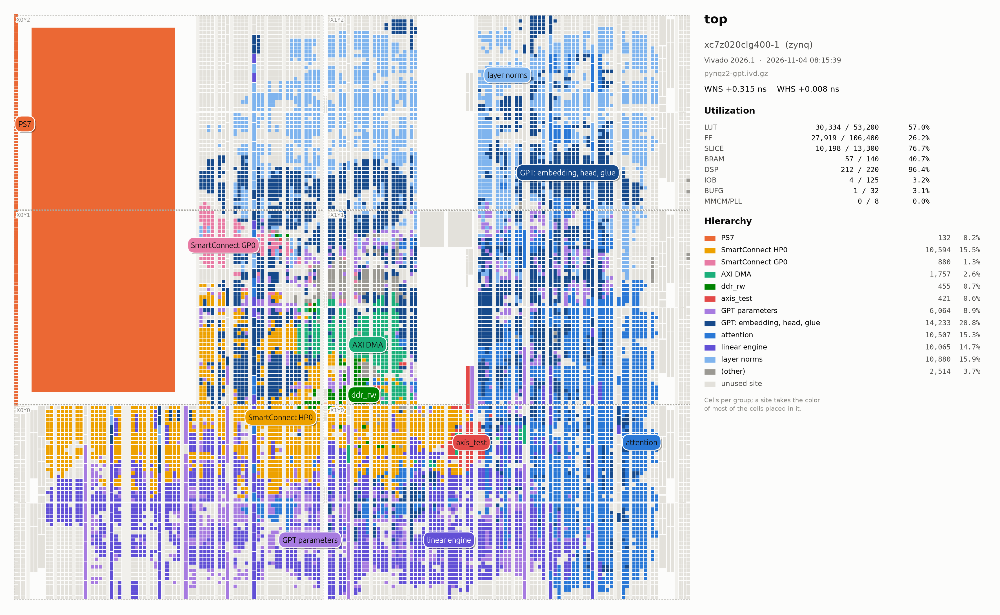
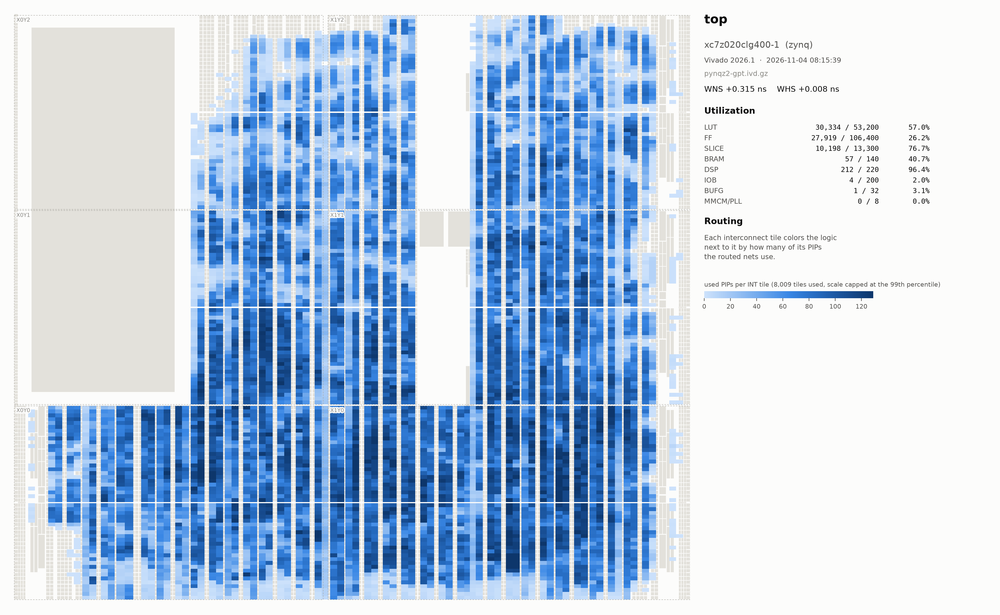
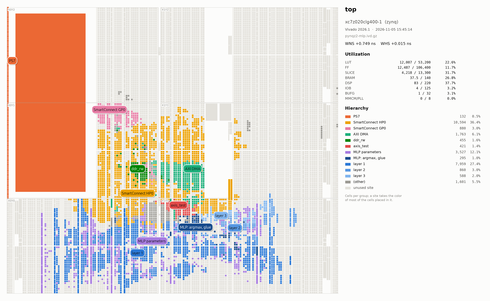
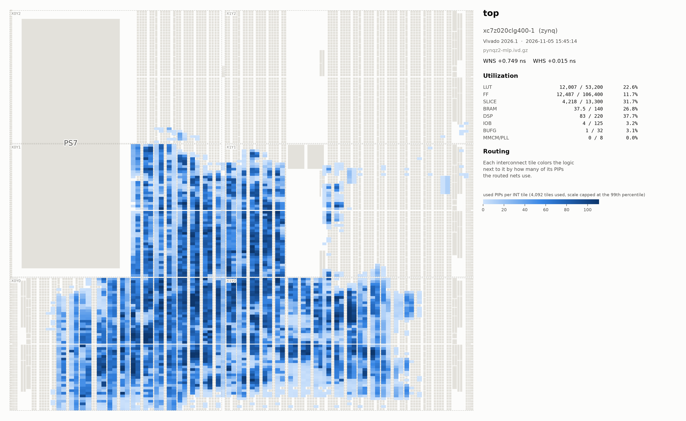

# Vivado implemented design renderer and viewer

This project was made with the help of Claude Opus 5.5.

`fpga-design-implview` draws what a Vivado implementation uses of the device: every site
of the part (slices, BRAM, DSP, URAM, IO, GT, clocking, hard blocks), lit up when the
design uses it and colored by hierarchy, with the part, WNS/WHS and the legend. The
part comes from the checkpoint: any design, any device.

## Examples

PYNQ-Z2 (xc7z020), placement and routing usage:

<p>


</p>

<p>


</p>

Note: the text on the right is optional, `--no-panel` leaves only the device.

## Install

```sh
pipx install fpga-design-implview   # or pip; Python 3.11+
```

The command is `fpga-design-implview`, or `implview` for short. Vivado is needed to read
the checkpoint (with a license for its device); drawing works without it.

## Usage

```sh
fpga-design-implview render path/to/impl_1               # <top>.png, <top>.pdf
fpga-design-implview render top_routed.dcp -o top.html   # interactive viewer
fpga-design-implview render path/to/impl_1 -H highlight.toml --stats --theme dark
```

The input is a run directory, a project directory or a routed checkpoint. The output
format follows the extension: `.png` (placement, plus `_routing.png`), `.pdf`, `.svg`,
`.html`.

The first run opens the checkpoint in Vivado (batch mode) and caches the export in
`~/.cache/implview`, so later renders take seconds. Vivado is `$IMPLVIEW_VIVADO` (or
`--vivado CMD` before the command), else `vivado` on the PATH, else the install under
`~/opt/xilinx`, `~/Xilinx`, `/opt/Xilinx` or `/tools/Xilinx` matching the checkpoint's
version.

| Option                     | What                                              |
|----------------------------|---------------------------------------------------|
| `-o FILE`, `-O DIR`        | output file (repeatable), output directory        |
| `-H FILE`                  | highlight file: what to color and how             |
| `-g PATH`                  | color a hierarchy path (repeatable)               |
| `--depth N`                | automatic groups cut at depth N                   |
| `--stats`                  | utilization table and cells per group             |
| `--theme dark`             | dark theme                                        |
| `--no-routing`             | skip the routing page (faster first export)       |
| `--paths N`                | N worst setup and hold paths (default 50, 0 none) |
| `--no-panel`, `--no-labels` | device only, no names on it                    |
| `--save-highlight FILE`    | write the groups used as a highlight file         |
| `--refresh`                | export again, ignore the cache                    |

Other commands: `export` (only the export), `device PART` (only the device), `info`
(part, top, cache status), `tcl` (path of `implview.tcl`).

## Colors

By default the hierarchy is split into up to 8 groups. A highlight file (`-H`) chooses:

```toml
[[highlight]]
path = "u_core/u_fft"                # * inside one level, ** any depth
color = "#2a78d6"
label = "FFT"

[[highlight]]
path = "u_core/gen_ch[*].u_filter"   # a generate loop: one shade per instance
color = ["#8fe0bb", "#0f6e4b"]
label = "filter"

[options]
others = "grey"                      # or "hide"; also theme, stats, labels, panel
```

The most specific path holds a cell. More in
[examples](https://github.com/rardino/fpga-design-implview/tree/main/examples).

## Viewer

Scroll to zoom, drag to pan, `F` to fit. Hover a site for its cells, click to pin them,
click a cell to highlight its module. Search cell names (`*`, `?`), toggle groups and
layers (routing, clock regions, pblocks), switch light/dark, save the view as PNG.

Timing paths: the worst setup and hold paths are listed in the panel. Click one (or WNS,
WHS) to draw it over the sites it goes through, from the ring to the dot, with its slack,
clocks, logic/net split, clock regions and cells. A pinned site lists the paths through
it. *Timing report* shows Vivado's `report_timing` of the path with the site names as
links; *Copy Tcl* gives the `report_timing` command that opens the same path in Vivado.
`N`/`P` step through the paths, `#path=s3` in the URL opens one.

## From a build script

Export at the end of the implementation run, in the same Vivado session, to skip
opening the checkpoint again (`fpga-design-implview tcl` prints the script's path):

```tcl
source /path/to/implview.tcl
implview::export_all $out/implview -routing -paths 50  ;# <top>.ivd.gz and <part>.ivdev.gz
```

then `fpga-design-implview render $out/implview/<top>.ivd.gz`.

## Status

Tried on Zynq-7000 (xc7z020) and Virtex UltraScale+ HBM (xcvu37p, three SLRs).
UltraScale, Zynq UltraScale+ and Versal are not tried yet. Nets are not drawn, only how
much each interconnect tile is used; timing paths are straight lines from site to site. The picture follows Vivado's tile grid, not the die
to scale.

Tests, from a clone: `pip install -e .[test] && pytest` (no Vivado needed).
