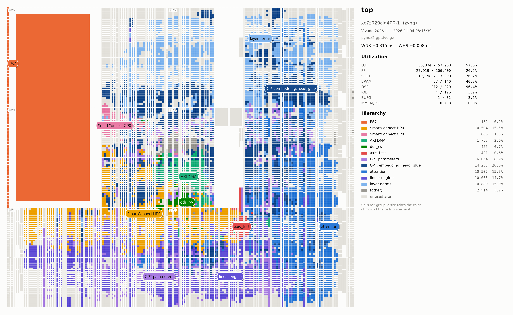
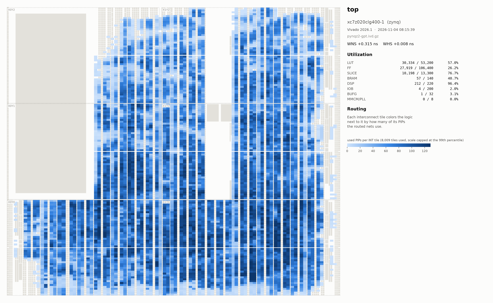
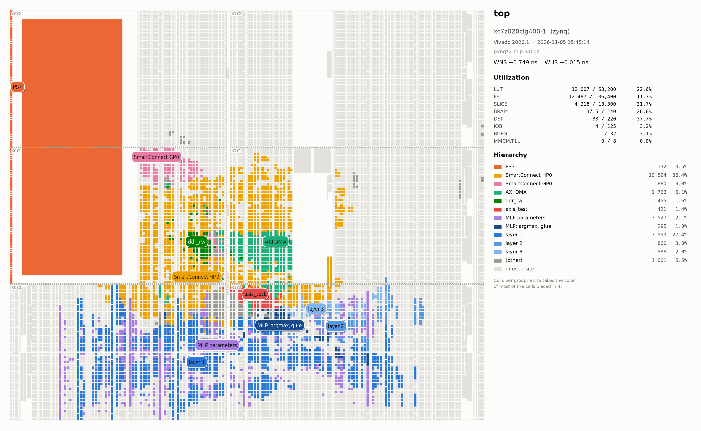
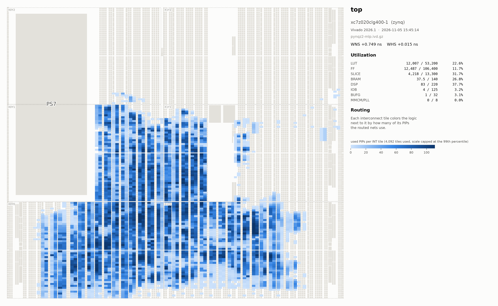

# Vivado implemented design renderer and viewer

This project was made with the help of Claude Opus 5.5.

`fpga-design-implview` draws what a Vivado implementation uses of the device: every site
of the part (slices, BRAM, DSP, URAM, IO, GT, clocking, hard blocks), lit up when the
design uses it and colored by hierarchy, with the part, WNS/WHS and the legend. The
part comes from the checkpoint: any design, any device.

Compiled Quartus projects are read too, in a first version: see [Quartus](#quartus).

## Examples

PYNQ-Z2 (xc7z020), placement and routing usage:

<p>


</p>

<p>


</p>

Note: the text on the right is optional, `--no-panel` leaves only the device.

## Install

```sh
pipx install fpga-design-implview   # or pip; Python 3.11+
```

The command is `fpga-design-implview`, or `implview` for short. Vivado is needed to read
the checkpoint (with a license for its device); drawing works without it.

## Usage

```sh
fpga-design-implview render path/to/impl_1               # <top>.png, <top>.pdf
fpga-design-implview render top_routed.dcp -o top.html   # interactive viewer
fpga-design-implview render path/to/impl_1 -H highlight.toml --stats --theme dark
```

The input is a run directory, a project directory or a routed checkpoint (or a compiled
[Quartus](#quartus) project). The output format follows the extension: `.png` (placement,
plus `_routing.png`), `.pdf`, `.svg`, `.html`.

The first run opens the checkpoint in Vivado (batch mode) and caches the export in
`~/.cache/implview`, so later renders take seconds. Vivado is `$IMPLVIEW_VIVADO` (or
`--vivado CMD` before the command), else `vivado` on the PATH, else the install under
`~/opt/xilinx`, `~/Xilinx`, `/opt/Xilinx` or `/tools/Xilinx` matching the checkpoint's
version.

| Option                     | What                                              |
|----------------------------|---------------------------------------------------|
| `-o FILE`, `-O DIR`        | output file (repeatable), output directory        |
| `-H FILE`                  | highlight file: what to color and how             |
| `-g PATH`                  | color a hierarchy path (repeatable)               |
| `--depth N`                | automatic groups cut at depth N                   |
| `--stats`                  | utilization table and cells per group             |
| `--theme dark`             | dark theme                                        |
| `--no-routing`             | skip the routing page (faster first export)       |
| `--paths N`                | N worst setup and hold paths (default 50, 0 none) |
| `--no-panel`, `--no-labels` | device only, no names on it                    |
| `--save-highlight FILE`    | write the groups used as a highlight file         |
| `--refresh`                | export again, ignore the cache                    |

Other commands: `export` (only the export), `device PART` (only the device), `info`
(part, top, cache status), `tcl` (path of `implview.tcl`).

## Colors

By default the hierarchy is split into up to 8 groups. A highlight file (`-H`) chooses:

```toml
[[highlight]]
path = "u_core/u_fft"                # * inside one level, ** any depth
color = "#2a78d6"
label = "FFT"

[[highlight]]
path = "u_core/gen_ch[*].u_filter"   # a generate loop: one shade per instance
color = ["#8fe0bb", "#0f6e4b"]
label = "filter"

[options]
others = "grey"                      # or "hide"; also theme, stats, labels, panel
```

The most specific path holds a cell. More in
[examples](https://github.com/rardino/fpga-design-implview/tree/main/examples).

## Viewer

Scroll to zoom, drag to pan, `F` to fit. Hover a site for its cells, click to pin them,
click a cell to highlight its module. Search cell names (`*`, `?`), toggle groups and
layers (routing, clock regions, pblocks), switch light/dark, save the view as PNG.

Timing paths: the worst setup and hold paths are listed in the panel. Click one (or WNS,
WHS) to draw it over the sites it goes through, from the ring to the dot, with its slack,
clocks, logic/net split, clock regions and cells. A pinned site lists the paths through
it. *Timing report* shows Vivado's `report_timing` of the path with the site names as
links; *Copy Tcl* gives the `report_timing` command that opens the same path in Vivado.
`N`/`P` step through the paths, `#path=s3` in the URL opens one.

## From a build script

Export at the end of the implementation run, in the same Vivado session, to skip
opening the checkpoint again (`fpga-design-implview tcl` prints the script's path):

```tcl
source /path/to/implview.tcl
implview::export_all $out/implview -routing -paths 50  ;# <top>.ivd.gz and <part>.ivdev.gz
```

then `fpga-design-implview render $out/implview/<top>.ivd.gz`.

## Quartus

A compiled Quartus project (Altera parts) is read from the files of the compilation,
without Quartus:

```sh
fpga-design-implview render path/to/project              # or its .qpf, its .qsf
fpga-design-implview render path/to/project -o top.html --stats
```

The placement comes from the post-fit netlist of the EDA Netlist Writer
(`simulation/<tool>/<revision>.vo` or `.vho`), which gives the location of every cell;
the utilization, the pins and their I/O banks from the Fitter report; the worst slacks
from the Timing Analyzer summary. A project compiled without a simulation tool has no
netlist; this writes it:

```sh
quartus_eda <project> -c <revision> --simulation=on --tool=modelsim --format=verilog
```

Quartus cannot list the resources of a device, so the device map is inferred from the
placement: every location in use, the unused LABs, memory and DSP blocks of the columns
in use (inside the outline of what is placed), and the pads of the pins in use. A design
that fills the device shows nearly all of it, a small one only the part around it; the
log says how much (`LAB 1,287 of 1,395, M9K 66 of 66`). `--stats` is the utilization of
the Fitter report: ALMs or LEs, LABs, memory blocks and bits, DSP, pins, PLLs.

Tried on the files of Cyclone IV E, Cyclone V SoC and MAX 10 designs, Quartus 13.1 to
20.1; other families and Quartus Pro are not tried. Not there yet: routing usage, timing
paths, LogicLock regions, and the PLLs and clock buffers that Quartus places without
coordinates (`PLL_1`, `CLKCTRL_G3`).

## Status

Tried on designs for Zynq-7000 (xc7z020), Kintex UltraScale (xcku040), Zynq UltraScale+
(xczu7ev, with the PS), Virtex UltraScale+ HBM (xcvu37p, three SLRs) and Versal (VC1902,
one with CIPS, NoC and DDR4), and on the device maps of Virtex UltraScale (xcvu440, three
SLRs; xcvu095), RFSoC (xczu28dr) and Versal Premium (xcvp1802, four SLRs), HBM (xcvh1582),
AI Edge (xcve2302) and AI Edge Gen 2 (xc2ve3858). Nets are not drawn, only how much each
interconnect tile is used; timing paths are straight lines from site to site. The picture
follows Vivado's tile grid, not the die to scale.

On Versal the AI Engine array and the bottom row (XPIO, memory controllers, clocking) have
no interconnect, so their rows are thin: zoom in the PDF or the viewer. `--stats` counts as
`report_utilization` does: bonded IOB pads (two per XPIO site) and GTs, and the hard blocks
of the part (PCIe, CMAC, Interlaken, VCU, RF data converters, SD-FEC, NoC NMU/NSU, DDRMC,
HBM controllers).

Tests, from a clone: `pip install -e .[test] && pytest` (no Vivado needed).

## Detailed view and cross-check (`--detail`, `crosscheck`)

This copy adds a detailed export, an interactive viewer for it, and a check of
the export against the bitstream. The default export is unchanged; everything
below needs `--detail`.

```sh
implview render top_routed.dcp -o top.html --detail            # viewer with cells, nets, routes
implview render top_routed.dcp -o top.html --detail --nets 5000
implview crosscheck top_routed.dcp -O xcheck                   # 7-series: export vs bitstream
implview import-nextpnr placed.json --fasm top.fasm --part xc7s25csga324-1 -o np.ivd.gz
implview render np.ivd.gz -o np.html                           # open-flow build, same viewer
```

### Detail export (`--detail`, `--nets N`)

`implview::export_design ... -detail ?-nets N?` (tcl/implview.tcl) adds:

| Record | Content |
|---|---|
| `C` | per placed cell: LUT `INIT` and the logical-to-BEL pin map (`I0:A6 ...`); FF/latch `INIT` and `IS_*_INVERTED`; key BRAM, DSP, IO and clocking properties |
| `W`, `Q` | every top-level net: name, type (signal / clock), fanout, route status; its leaf pins, driver first |
| `G` | the route of up to N nets (default 20000; clock nets and the nets on the exported timing paths go first) as tile-to-tile segments: for each pip, uphill node tile, pip tile, downhill node tile |
| `I` | the pips of each routed net (used by `crosscheck`) |

The cell name, REF_NAME, SITE and BEL were already exported; the hierarchy parent comes from the name.
The cache key includes `--detail` and `--nets`; a detail export also serves a plain render.

### Viewer

All in one offline HTML file, as before, plus:

- **Module tree**: click a module to light up its sites. Selecting a site expands the tree to its module, and the two stay in sync.
- **Site panel**: each cell shows the LUT equation (a minimized sum of products over I0..In, computed from INIT), the pin map (I0 to A6 and so on), FF/BRAM/DSP/IO/clock settings, and every pin with its net as a link.
- **Nets**: search by name (wildcards allowed; clock nets are listed first). The selected net is drawn as its routed tile path, with the driver site in a thick box and the load sites in thin boxes. A layer toggle shows the whole clock network.
- **Timing paths**: clicking a path now also draws the nets it uses.
- **URL hash** for links and screenshots: `#net=NAME`, `#module=PATH`, `#site=SITE`, `#path=s1`, `#layer=clocks`, `#theme=dark`.

Without `--detail` the page is the same as before, plus the module tree.

The LUT equation is computed in Python (`lut.py`, Quine-McCluskey with a greedy cover) for LUT1..LUT6 cells only. SRL, LUTRAM and CFGLUT cells are listed with their INIT.

### Cost on the test designs (Vivado 2025.2.1, WSL, 5 GB RAM)

| Design | Part | Cells / nets | Vivado export, plain / detail | Total with Vivado start | Design file | HTML |
|---|---|---|---|---|---|---|
| digital_clock (with ILA) | xc7a35ti (Artix-7) | 3510 placed cells / 3649 nets, 29885 pips | 3.1 s / 7.3 s | 16 s / 18 s, peak 1.9 GB | 60 KB / 450 KB | 184 KB / 409 KB |
| uart16450 | xc7s25 (Spartan-7) | 577 placed cells / 653 nets, 5477 pips | 4.6 s / 6.2 s | 14 s / 15 s, peak 1.7 GB | 29 KB / 93 KB | 120 KB / 158 KB |

The route lookup costs about 0.1 ms per pip (two node queries), so a design with 1 M pips adds about 2 minutes; `--nets` caps it.

UltraScale+ and Versal: the Vivado 2025.2.1 install here has only 7-series devices (`get_parts` lists 44 devices, all xc7/xa7), so no UltraScale+ or Versal design could be built or exported. The detail export uses only family-neutral Tcl (cells, `get_pips`, `get_nodes -uphill/-downhill`, tile names), and the viewer maps tiles through the device file, which already handles UltraScale+ and Versal. This is untested on real UltraScale+ or Versal checkpoints.

### Crosscheck (`implview crosscheck`)

For a 7-series checkpoint the command:

1. exports `--detail` with no net cap;
2. writes the bitstream in Vivado (or takes `--bit`), along with the VCC/GND net pips, `report_route_status`, and a per-net check that the ROUTE property and `get_nodes` agree;
3. decodes the bitstream with Project X-Ray `bit2fasm` (openXC7 install in `~/tools/openxc7`, or `$IMPLVIEW_BIT2FASM`; prjxray-db from `$IMPLVIEW_PRJXRAY_DB` or known places);
4. compares the two and writes `crosscheck.md` and `crosscheck.json`, with mismatch samples.

The comparisons are:

- **Used SLICEs and LUT/FF BELs.** Unused slices still decode their default features (NOCLKINV, PRECYINIT.C0, the SLICEM DI1MUX settings), so those are ignored.
- **Physical LUT INIT.** The logical INIT is permuted through the pin map and compared on the half of the table the BEL uses: A6=1 when the 5LUT is in use or A6 is not used, A6=0 for the 5LUT.
- **FF ZINI/ZRST per FF**, and CEUSEDMUX, SRUSEDMUX, FFSYNC, LATCH and CLKINV per slice.
- **PIPs.** Only pips with configuration bits in the database count. Bidirectional pips match in either direction. Unused BUFGCTRL input muxes decode as set (default bits) and are reported apart. So are the BRAM `ADDR*U` muxes: all 30 are in BRAM_L_X30Y0, the tile of the used RAMB18_X1Y0, and they have no Vivado pip. They are probably the upper-half address muxes Vivado sets for a RAMB18, but this is not proven, so the raw percentage is reported too.

| Check | Artix-7 digital_clock | Spartan-7 uart16450 |
|---|---|---|
| Used SLICEs | 602 / 602, 100 % | 92 / 92, 100 % |
| LUT BELs found | 1050, 100 % | 219, 100 % |
| FF BELs | 1974, 100 % | 270, 100 % |
| LUT physical INIT | 1265, 100 % | 278, 100 % |
| FF ZINI/ZRST | 1974, 100 % | 270, 100 % |
| CE / SR / FFSYNC per slice | 549 slices, 100 % each | 84 slices, 100 % each |
| LATCH / CLKINV per slice | not exercised (no latch or inverted clock in either design; agreement is only on absence) | same |
| Vivado pips found in FASM | 15489, 100 % | 2673, 100 % |
| FASM pips explained by Vivado (raw / without defaults) | 99.41 % / 99.99 % | 98.85 % / 100 % |
| ROUTE vs get_nodes, per net | 2721 nets, 100 % | 449 nets, 100 % |
| Crosscheck run time (bitstream included) | 59 s | 49 s |

- **Artix-7.** The one FASM routing feature left unexplained is `CFG_CENTER_MID.BSCAN.JTAG_CHAIN_1`, a BSCAN site setting of the debug hub, not a route. 333 LUT BELs carry INIT bits without a LUT1..6 cell: route-thrus, constants, and SRL/LUTRAM of the ILA.
- **Spartan-7.** 48 LUT BELs with INIT but no LUT cell.
- **Artix-7 part name.** The checkpoint's part is xc7a35ti, so the database part used is xc7a35tcsg324-1, which has the same fabric.
- **UltraScale+ / Versal.** There is no public bitstream database for Versal, and prjuray is not installed (nor are UltraScale+ devices). For those families `crosscheck` runs the Vivado checks only.

**Open flow.** `--nextpnr placed.json --nextpnr-fasm top.fasm` adds a comparison with an independent build of the same RTL (Yosys `synth_xilinx` and nextpnr-xilinx). `import-nextpnr` turns that build into a design file, drawn by the same viewer from nextpnr's BEL placement and the per-tile FASM pips. For uart16450 on xc7s25:

| | Vivado 2024.1 | Yosys 0.69 + nextpnr-xilinx |
|---|---|---|
| LUT cells | 278 | 606 (173 LUT1 feed-throughs from the packer) |
| FFs | 270 | 269 |
| CARRY4 | 14 | 29 |
| SLICEs | 92 | 174 |
| INT pips | 3379 | 4651 |

The FF count matches. The open flow uses about twice the logic. Note that `xc7s25csga324-1.chipdb` and `_v3.chipdb` in `~/fpga-toolchain/nextpnr-xilinx` placed logic on SLICE rows Y100..Y110, which this part does not have (Vivado's xc7s25 stops at Y99). `xc7s25csga324-1_new.chipdb` has the right grid and was used.

Screenshots (headless Edge, `docs/plus/shot_edge.sh`) are in `docs/plus/`:

| Screenshot | Shows |
|---|---|
| `a7_default.png` | the default view |
| `a7_site.png` | a site with LUT equations |
| `a7_net.png` | the routed clock net `u_clk/clk_div`, dark theme |
| `a7_clocks.png` | the clock layer and a module selected from the tree |
| `a7_path.png` | a timing path with its nets |
| `a7_bram.png` | a BRAM site with its RAMB18 settings and pin nets |
| `a7_plain.png` | the page without `--detail` (timing path) |

The crosscheck reports are in `docs/plus/crosscheck/`.

### Limitations

- A route is drawn tile to tile, as straight lines between tile centers. Long and clock wires are drawn from their start tile (the node's base tile) to the pip tile, so they show where a wire runs, not the exact track.
- A timing path draws the whole of each net it uses, including the branches to other loads.
- Large designs: the HTML grows with the number of cells and with the route segments of up to `--nets` nets. On devices with millions of pips, lower `--nets`.
- The LUT pin map needs one Vivado query per LUT input pin (about 0.1 ms each).
- Pins tied to VCC/GND have no net entry (the constant nets are not listed), so a CE tied high shows no CE pin.
- Nets on timing paths get route priority from the 50 worst setup and 50 worst hold paths, whatever `--paths` is set to.
- `crosscheck` works only on 7-series with a Project X-Ray database. Default-bit classes are filtered by name, so new kinds of default features show up as unexplained FASM features.
